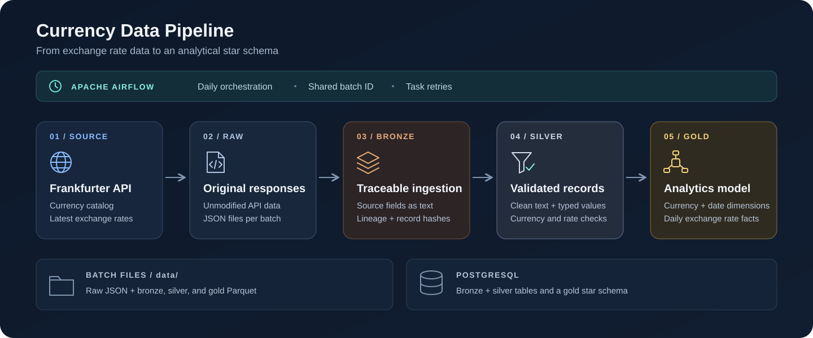

# Currency Data Pipeline



A currency exchange rate pipeline built with Python, Polars, PostgreSQL, and Apache Airflow. It extracts data from the Frankfurter v2 API and processes it through raw, bronze, silver, and gold layers for analytical queries.

## Pipeline

```text
Frankfurter API -> Raw JSON -> Bronze -> Silver -> Gold
```

| Layer | Purpose | Outputs |
| --- | --- | --- |
| Raw | Fetch the currency catalog and latest rates. Defaults to BRL as the base and all available quote currencies. | JSON files for `currencies` and `rates`. |
| Bronze | Preserve source fields as nullable text and add file lineage, batch ID, ingestion timestamp, and record hash. | Parquet files and `bronze.currencies` / `bronze.rates`. |
| Silver | Clean text, normalize currency codes, parse dates, and convert rates to `Float64`. Reject invalid records by failing the batch. | Parquet files and `silver.currencies` / `silver.rates`. |
| Gold | Build a star schema with stable keys and one exchange rate per date, base currency, and quote currency. | Parquet files and `gold.dim_currency`, `gold.dim_date`, and `gold.fact_exchange_rate`. |

Silver preserves bronze metadata and rows without deduplication. Gold validates the persisted silver files, resolves dimensions, deduplicates records, and retains only business attributes and keys.

## Setup

### 1. Install prerequisites

Install Git, Docker with Compose v2, and [uv](https://docs.astral.sh/uv/getting-started/installation/). Start Docker before running Compose commands. On Windows, use Docker Desktop with Linux containers.

Install uv on Windows:

```powershell
winget install --id=astral-sh.uv -e
```

Or on Linux/macOS:

```bash
curl -LsSf https://astral.sh/uv/install.sh | sh
```

Open a new terminal after installation. The Compose stack checks for at least 4 GB of memory and recommends 2 CPUs and 10 GB of disk space.

### 2. Clone the repository

```bash
git clone https://github.com/carlosmichelutti/currency-data-pipeline.git
cd currency-data-pipeline
```

Run all remaining commands from this directory.

### 3. Install Python and dependencies

```bash
uv python install 3.13
uv sync --locked
```

The repository pins Python 3.13. uv creates `.venv` and installs the locked dependencies, including development tools. See [uv's syncing documentation](https://docs.astral.sh/uv/concepts/projects/sync/) for lockfile behavior.

Airflow 3.3.0 is installed locally on Linux/macOS. On native Windows, it is excluded; run Airflow through Docker. The layer scripts work locally on Windows.

### 4. Configure the environment

Copy the example configuration on Linux/macOS:

```bash
cp .env.example .env
```

On Windows PowerShell:

```powershell
Copy-Item .env.example .env
```

Review these settings in `.env`:

| Variable | Default / configuration |
| --- | --- |
| `DATABASE_HOST` | `localhost` for scripts running on the host. |
| `DATABASE_PORT` | `5432`; choose another available host port if needed. |
| `DATABASE_NAME` | `currency_pipeline` |
| `DATABASE_USER` | `currency_pipeline` |
| `DATABASE_PASSWORD` | `currency_pipeline` for local development. |
| `AIRFLOW_UID` | `50000` on Windows/macOS; on Linux, use the output of `id -u`. |
| `FERNET_KEY` | For Airflow, generate a key below and paste it here. |

```bash
uv run python -c "import base64, secrets; print(base64.urlsafe_b64encode(secrets.token_bytes(32)).decode())"
```

The `.env` file and generated pipeline data are ignored by Git. This Compose configuration is intended for local development.

## Run locally, layer by layer

After setup, start the pipeline database and wait for it to become healthy:

```bash
docker compose up -d --wait postgres-currency-pipeline
```

Run the layers in this order:

```bash
uv run python -m scripts.extract
uv run python -m scripts.bronze
uv run python -m scripts.silver
uv run python -m scripts.gold
```

Extraction creates a batch ID in `YYYYMMDDHHMMSS` format using UTC-03:00. Each downstream script selects the latest complete batch in its input layer. SQL files under `sql/<layer>/` create or update schemas and tables automatically before loading; no manual DDL execution is needed.

To reprocess a specific existing batch, pass its ID without the `batch_id=` prefix:

```bash
uv run python -m scripts.bronze --batch-id 20261015120000
uv run python -m scripts.silver --batch-id 20261015120000
uv run python -m scripts.gold --batch-id 20261015120000
```

For a file-only run, complete setup, skip starting PostgreSQL, and execute:

```bash
uv run python -m scripts.extract
uv run python -m scripts.bronze --skip-database
uv run python -m scripts.silver --skip-database
uv run python -m scripts.gold --skip-database
```

To customize extraction from Python:

```python
from scripts.extract import run_extract

result = run_extract(base="BRL", quotes=["USD", "EUR"])
print(result)
```

`extract_rates()` also accepts `date` or `start_date` / `end_date` for historical queries. The default pipeline always fetches the latest available rates.

## Run with Airflow (alternative)

After setup, build the image and initialize Airflow. Wait for initialization to finish successfully before starting the stack:

```bash
docker compose up --build airflow-init
docker compose up -d
docker compose ps
```

Compose starts the Airflow API server, scheduler, DAG processor, Celery worker, triggerer, Redis, and two PostgreSQL services: one for Airflow metadata and one for pipeline data. Containers connect to the pipeline database at `postgres-currency-pipeline:5432`; the host uses the settings in `.env`.

1. Wait for the services to become healthy, then open [Airflow](http://localhost:8080).
2. Sign in with `airflow` / `airflow` unless you set `_AIRFLOW_WWW_USER_USERNAME` and `_AIRFLOW_WWW_USER_PASSWORD` in `.env`.
3. Find `currency_exchange_rates_dag` and trigger a manual run.
4. Check task status and logs in the DAG view. Unpause the DAG to enable scheduled runs.

```text
generate_batch_id -> run_extract -> run_bronze -> run_silver -> run_gold
```

The DAG runs daily at midnight in `America/Sao_Paulo`, starting October 15, 2026, with catchup disabled and one active run at a time. Tasks retry up to three times at five-minute intervals. All tasks share a batch ID derived from the logical date, or the fixed run timestamp for manual runs. This identifies ingestion; it does not filter source rates by that date.

Rebuild after changing dependencies with `docker compose up -d --build`. Stop services with `docker compose down`; database volumes and files in `data/` are preserved.

## Results and return values

Files are partitioned by ingestion batch:

```text
data/raw/<dataset>/batch_id=<id>/data.json
data/bronze/<dataset>/batch_id=<id>/<dataset>.parquet
data/silver/<dataset>/batch_id=<id>/<dataset>.parquet
data/gold/<table>/batch_id=<id>/<table>.parquet
```

`<dataset>` is `currencies` or `rates`; `<table>` is `dim_currency`, `dim_date`, or `fact_exchange_rate`. Docker shares these files with the host through `/opt/airflow/data`.

| Python function | Returned dictionary |
| --- | --- |
| `run_extract()` | `batch_id`, `currencies_path`, `rates_path` |
| `run_bronze()` / `run_silver()` | The same keys, plus `currencies_rows` and `rates_rows`. |
| `run_gold()` | `batch_id`, plus `<table>_path` and `<table>_rows` for each gold table. |

Paths are absolute. Airflow shares these small dictionaries through XCom; CLI commands write progress and results to logs. Row counts depend on the API response and batch contents.

Rerunning a batch replaces its files. Bronze and silver replace only that batch's database rows using transactional `COPY` loads. Gold upserts shared dimensions and daily facts across batches: currency attributes are updated in place (SCD type 1), overlapping rates use the latest successful load, and absent facts are preserved. Gold Parquets contain only the current batch; its PostgreSQL tables accumulate results across batches. Database loads are transactional per layer; files remain available if a database load fails.

Query the final model in a PostgreSQL client connected with your `DATABASE_*` settings:

```sql
SELECT d.date, b.iso_code AS base, q.iso_code AS quote, f.rate
FROM gold.fact_exchange_rate AS f
JOIN gold.dim_date AS d ON d.date_key = f.date_key
JOIN gold.dim_currency AS b ON b.currency_key = f.base_currency_key
JOIN gold.dim_currency AS q ON q.currency_key = f.quote_currency_key
ORDER BY d.date DESC, base, quote
LIMIT 20;
```

Each row means **1 unit of the base currency = rate units of the quote currency**. Rates use approximate floating-point values without explicit rounding.

## Tests

After setup:

```bash
uv run python -m unittest discover -s tests -v
```

On native Windows, DAG tests are skipped. To include them, build the Docker image as described above, then run the suite in Linux:

```bash
docker compose run --rm --no-deps --volume ./tests:/opt/airflow/tests:ro -e PYTHONPATH=/opt/airflow airflow-cli python -m unittest discover -s /opt/airflow/tests -v
```

PostgreSQL integration tests are opt-in: set `GOLD_TEST_DSN` to a disposable database without an existing `gold` schema. They are skipped by default.
