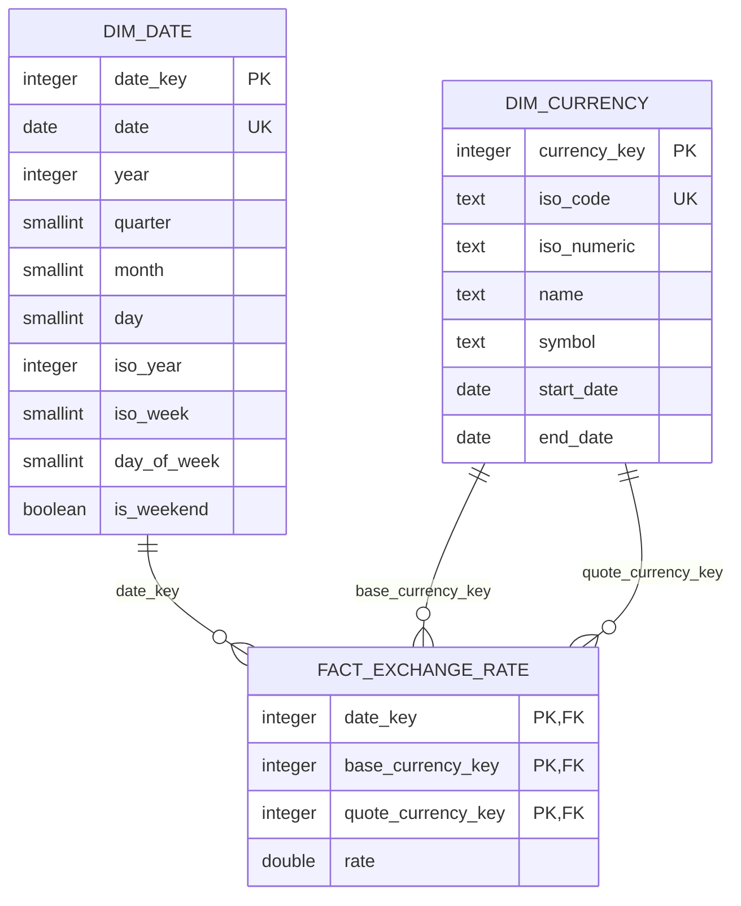

# Modelo dimensional da camada gold

A gold lê os dois Parquets silver do mesmo lote e constrói um modelo estrela
para consultas de câmbio. O processamento usa funções com Polars; leitura,
escrita e transação ficam nas funções de orquestração. Nenhuma tabela de
métricas agrupadas é criada nesta etapa.

## Tabelas e granularidade

| Tabela | Uma linha representa | Chave primária |
| --- | --- | --- |
| `gold.dim_currency` | Uma moeda identificada pelo código ISO | `currency_key` |
| `gold.dim_date` | Um dia do calendário | `date_key` |
| `gold.fact_exchange_rate` | A cotação de um par direcionado em um dia | `(date_key, base_currency_key, quote_currency_key)` |



A dimensão de moeda é compartilhada por dois papéis. `base_currency_key`
identifica a moeda base; `quote_currency_key` identifica a moeda cotada. Cada
FK da fato aponta para exatamente um membro de sua dimensão. Uma moeda pode
aparecer como base e como cotada em diversas linhas. Não é necessária uma
tabela de dimensão separada para cada papel nem uma tabela de pares.

`rate` conserva o significado da silver: **1 unidade da moeda base equivale a
`rate` unidades da moeda cotada**. BRL/USD e USD/BRL são pares diferentes.
Não se criam taxas inversas, dias de cotação ausentes ou valores sintéticos.
A taxa permanece `Float64`/`DOUBLE PRECISION`, sem arredondamento adicional.
É uma medida não aditiva: somar taxas não representa um total de câmbio.

## Chaves e atributos

`currency_key` codifica as três letras do ISO em base 26, com A=0 até Z=25,
mais 1: `AAA=1`, `ZZZ=17576`. Esse mapeamento é determinístico e sem colisões
para os códigos validados. Reordenar o catálogo, adicionar moedas ou alterar
nomes não muda a chave. O SQL verifica a correspondência entre chave e código.
`iso_code` também tem uma restrição de unicidade.

A dimensão de moeda usa atualização de atributos no próprio registro (SCD
tipo 1). Não há histórico de versões dos atributos. `start_date` e `end_date`
continuam descrevendo a cobertura de publicação informada pela API, e não a
validade de uma versão dimensional. `iso_numeric`, símbolo e datas de
cobertura aceitam nulos, preservando zeros à esquerda no código numérico.

`date_key` é o inteiro `YYYYMMDD`. A dimensão de data contém todos os dias entre
a menor e a maior data de cotação **de cada lote**, incluindo lacunas e fins
de semana. Lotes disjuntos não preenchem automaticamente o intervalo entre
eles. Ano, trimestre, mês e dia são atributos do calendário; `iso_year` e
`iso_week` seguem o calendário ISO, e `day_of_week` vai de 1 (segunda-feira) a
7 (domingo). A SQL valida os atributos contra a data. Lotes sem cotações geram
uma dimensão de data vazia com esquema tipado.

## Qualidade, linhagem e reexecução

- Registros iguais nos campos de negócio são reduzidos a um registro por chave.
  A linha com menor `_source_row_number` fornece a linhagem.
- Atributos diferentes para o mesmo ISO, ou taxas diferentes para a mesma
  data/base/quote **no mesmo lote**, interrompem o processamento.
- Referências de base, quote e data precisam existir nas dimensões do lote.
  Nenhuma cotação é descartada silenciosamente em joins.
- A gold reaproveita a validação da silver para códigos ISO, datas e taxas
  positivas e finitas. Metadados obrigatórios não podem ser nulos e o
  `_ingestion_batch_id` precisa coincidir com o lote solicitado.
- A dimensão de moeda e a fato preservam os sete metadados de origem da silver.
  `_record_hash` identifica o registro de origem, sem ser recalculado com as
  chaves gold. A dimensão de data é derivada e não recebe linhagem de uma linha.

Todos os datasets e relacionamentos são validados antes da primeira escrita.
Os Parquets são gravados atomicamente por arquivo e representam o lote:

```text
data/gold/
├── dim_currency/<batch_id>/dim_currency.parquet
├── dim_date/<batch_id>/dim_date.parquet
└── fact_exchange_rate/<batch_id>/fact_exchange_rate.parquet
```

A atomicidade dos arquivos é individual: uma falha de disco entre arquivos
pode deixar apenas parte das saídas atualizadas. Uma reexecução recompõe o
lote. Os arquivos permanecem disponíveis caso a carga no banco falhe.

No PostgreSQL, dimensões são compartilhadas entre os lotes e persistidas por
upsert, sem apagar membros utilizados por fatos anteriores. A carga remove
somente os fatos cujo `_ingestion_batch_id` ainda pertence ao lote solicitado
e faz upsert dos fatos pela chave de negócio composta. Isso permite remover
linhas de uma reexecução sem apagar cotações distintas de outros lotes.

Se outro lote trouxer a mesma data/base/quote, ele atualiza a linha existente,
incluindo a linhagem. **Prevalece a última carga executada com sucesso**, não
a ordem lexical dos lotes nem a data de ingestão. Reprocessar um lote antigo
pode substituir uma correção mais recente; este modelo não guarda versões de
cotações. Quando uma cotação passa a pertencer a outro lote, a reexecução do
lote anterior não a remove enquanto não a trouxer novamente como entrada.

DDL, upserts das dimensões, remoção dos fatos do lote e upsert dos fatos usam
uma única transação. Qualquer falha desfaz todas essas alterações no banco.
Um advisory lock transacional serializa as cargas gold feitas pelo script,
inclusive execuções concorrentes do mesmo lote. As FKs e a chave primária
impedem referências órfãs e duplicação do grão também em inserções diretas.

Os Parquets são saídas por lote; o banco mantém o estado acumulado do modelo.
Para consultas entre lotes, use as tabelas gold no PostgreSQL. Concatenar
Parquets de lotes sobrepostos pode duplicar fatos e membros dimensionais.

## Execução

```bash
uv run python -m scripts.gold
uv run python -m scripts.gold --batch-id 20261009090000
uv run python -m scripts.gold --batch-id 20261009090000 --skip-database
```

Sem lote explícito, seleciona o maior identificador lexical com os dois
Parquets silver completos; para identificadores `YYYYMMDDHHMMSS`, corresponde
ao mais recente. Os parâmetros `--silver-dir`, `--gold-dir` e `--sql-dir`
permitem configurar os caminhos. Também funciona com `python scripts/gold.py`.

A carga usa as configurações `DATABASE_*` existentes. Para subir o serviço
PostgreSQL definido no Compose:

```bash
docker compose up -d postgres-currency-pipeline
```

Em Python:

```python
from scripts.gold import run_gold

result = run_gold(batch_id="20261009090000", persist_database=False)
print(result["fact_exchange_rate_path"])
```

O retorno contém lote, caminhos absolutos e contagens de linhas das três
tabelas, permitindo o encadeamento na DAG:

```text
generate_batch_id → run_extract → run_bronze → run_silver → run_gold
```

## Funções reutilizáveis

Todas as funções possuem docstrings. As transformações recebem DataFrames e
devolvem novos DataFrames, sem modificar as entradas nem abrir conexões.

| Função | Parametrização e usos |
| --- | --- |
| `unique_records` | Recebe chaves, atributos e desempate; deduplica moedas e cotações com a mesma política de conflito. |
| `currency_key`, `date_key` | Recebem coluna de origem e alias para construir chaves estáveis. |
| `resolve_dimension_key` | Recebe dimensão, chave natural, chave dimensional e nome do papel; resolve data, moeda base e moeda cotada. |
| `upsert_table` | Recebe schema, tabela, colunas e chaves; persiste as duas dimensões e a fato com o writer compartilhado. |
| `build_currency_dimension`, `build_date_dimension`, `build_exchange_rate_fact` | Compõem as regras próprias de cada tabela. |
| `persist_parquet`, `require_columns`, `transform_currencies`, `transform_rates` | Reaproveitam as funções existentes da silver. |

## Scripts SQL

Os arquivos em `sql/gold` são executados em ordem a cada carga e também podem
ser executados manualmente nessa ordem:

1. `001_create_schema.sql`: schema `gold`.
2. `002_create_dim_currency.sql`: dimensão de moeda, unicidade e validações.
3. `003_create_dim_date.sql`: dimensão de data e consistência do calendário.
4. `004_create_fact_exchange_rate.sql`: fato, chave composta, três FKs e índices
   para data, moedas e lote. A chave primária já indexa o prefixo `date_key`.

Consulta detalhada, sem agregações:

```sql
SELECT
    d.date,
    b.iso_code AS base_currency,
    b.name AS base_currency_name,
    q.iso_code AS quote_currency,
    q.name AS quote_currency_name,
    f.rate,
    f._ingestion_batch_id
FROM gold.fact_exchange_rate AS f
JOIN gold.dim_date AS d ON d.date_key = f.date_key
JOIN gold.dim_currency AS b ON b.currency_key = f.base_currency_key
JOIN gold.dim_currency AS q ON q.currency_key = f.quote_currency_key
ORDER BY d.date, b.iso_code, q.iso_code;
```

## Validação

```bash
python -m unittest discover -s tests -p "test_gold.py" -v
```

Os testes de SQL em `test_gold_postgres.py` são opcionais e exigem a variável
`GOLD_TEST_DSN` apontando para um PostgreSQL descartável. Eles se recusam a
usar um banco que já tenha o schema `gold` e desfazem seus dados/DDL ao terminar.
Validam FKs, constraints, reexecução, sobreposição entre lotes e rollback.
O teste da DAG deve executar em Linux/WSL2 ou no container Airflow.
